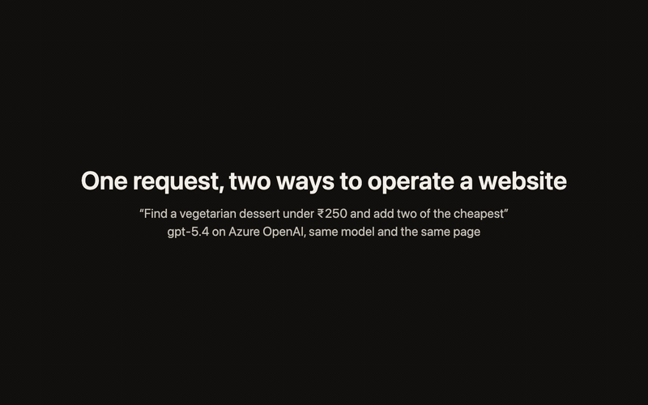
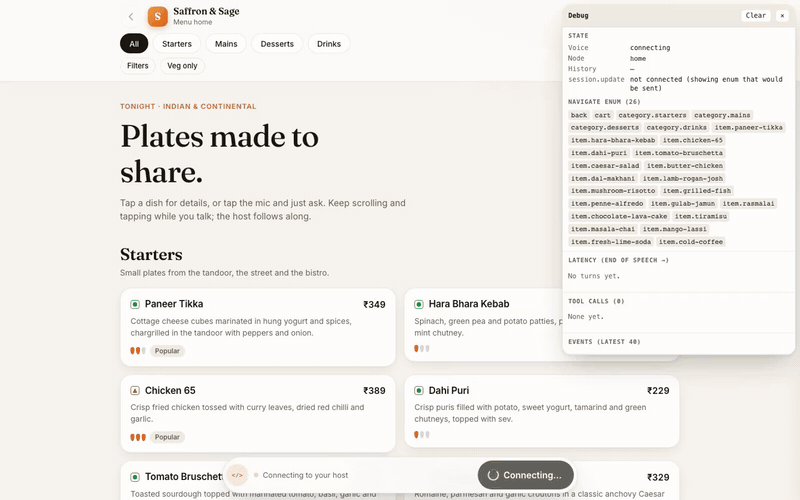
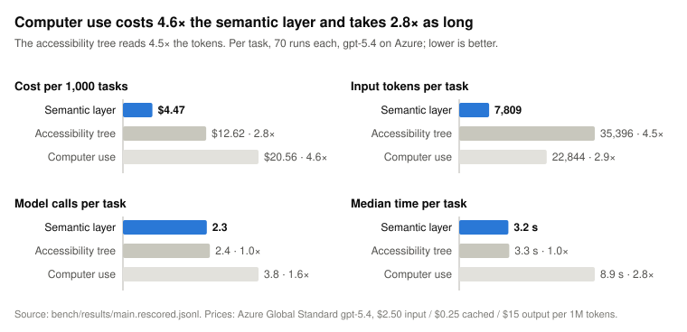

# Let websites speak for themselves

**Semantic actions vs computer use: a working prototype and a benchmark.**

A website that describes itself to an agent (a path graph, a short current-screen summary and a few
validated tools) lets the same model do the same tasks more accurately, more cheaply and faster than
reading the page's accessibility tree or its screenshots.



*The same typed request, the same model (gpt-5.4 on Azure OpenAI), the same page. Left HUD: live model
calls, input tokens and cost. Full-quality video: [docs/media/demo.mp4](docs/media/demo.mp4).
Re-record with `npx tsx bench/demo.ts`.*

**Voice.** The same layer driven by speech through gpt-realtime-2.1-mini over WebRTC: navigate,
open a dish, interrupt the host mid-answer, filter, and order (the host opens the confirmation and
leaves Confirm to the guest). The debug panel shows each tool call and its latency.



*The GIF is silent; [docs/media/voice-demo.mp4](docs/media/voice-demo.mp4) has both voices. The guest's voice
is synthesized with macOS `say` and played into a virtual microphone; the host is live.
Re-record with `npx tsx bench/voice-demo.ts`.*

**Read the article:** [docs/article.md](docs/article.md)
([shareable doc](https://claude.ai/artifact/NxnvthVzVdSRWSUmG8eneF)).

| 210 runs, gpt-5.4 on Azure | Passed | Input tokens per task | Cost per 1,000 tasks | Median time |
| --- | --- | --- | --- | --- |
| A. Semantic layer | **70/70** | **7,809** | **$4.47** | **3.2 s** |
| B. Accessibility tree | 58/70 | 35,396 | $12.62 | 3.3 s |
| C. Computer use | 48/70 | 22,844 | $20.56 | 8.9 s |



Raw per-run results are in [`bench/results/`](bench/results) (`combined.jsonl`, `combined.summary.md`).

## The prototype: Saffron & Sage voice menu

A restaurant menu you can use by touch or by voice. Each UI component is bound
to a node in a typed navigation graph and carries semantic metadata. A single
realtime voice model (Azure AI Foundry `gpt-realtime-2.1-mini`, over WebRTC, GA
Realtime protocol) listens, drives the UI through validated tool calls, and talks
to the guest. There is no separate text LLM or decision model.

## Requirements

- Node.js 20.12+ (tested on 22)
- An Azure AI Foundry / Azure OpenAI resource with a realtime deployment
- A browser with WebRTC and microphone access. Use `localhost` or HTTPS, because
  browsers block the mic on plain-HTTP LAN addresses.

## Setup

```bash
npm install
cp .env.example .env      # then paste your key into AZURE_OPENAI_API_KEY
```

| Variable | Purpose |
| --- | --- |
| `AZURE_RESOURCE` | Resource name → `https://<resource>.openai.azure.com` |
| `AZURE_REALTIME_DEPLOYMENT` | Realtime deployment name (`gpt-realtime-2.1-mini`) |
| `AZURE_OPENAI_API_KEY` | Resource key. **Server only**; never sent to the browser |
| `REALTIME_VOICE` | Output voice (`marin`) |
| `PORT` | Token service port (default 3001) |
| `REALTIME_TRANSCRIPTION_MODEL` | Optional. Caption transcription deployment (default `gpt-live-transcribe`; `whisper-1` invents phrases from silence) |
| `REALTIME_SILENCE_MS` | Optional. VAD end-of-turn silence (default 400) |
| `AZURE_ENDPOINT` | Optional. Overrides the base URL (used for testing against a mock) |

`.env` is git-ignored. Only `.env.example` is committed.

## Run

```bash
npm run dev       # token service (:3001) + Vite (:5173); open http://localhost:5173
```

Tap **Ask the host**, allow the microphone, and talk. Add `?debug` to the URL, or
tap the `</>` button, to open the debug panel.

To check the server: `curl localhost:3001/api/health` reports any missing config.

Production-style single process:

```bash
npm run build && npm start    # Express serves dist/ and /api on :3001
```

### Deploy (Azure App Service)

Runs on a Linux B1 App Service plan. The server is bundled into one file, so the app
needs no `npm install` at runtime. Config lives in the app's App Settings, not `.env`. The token service has no auth, so
restrict access (for example with App Service authentication) before exposing it publicly.

```bash
npm run build && npm run build:server
zip -qr app.zip dist dist-server package.json
az webapp deploy -g <resource-group> -n <app-name> --src-path app.zip --type zip
```

### Tests

```bash
npm test          # vitest: tool validation, session config, realtime protocol loop
npm run typecheck
```

## Architecture

```
server/index.ts              Express: GET /api/token → client_secrets → { token, expiresAt, callsUrl }
src/data/menu.ts             20 dishes / 4 categories, single source of truth
src/agent/paths.ts           navigation graph (PathNode per home/back/cart/category/item)
src/agent/store.ts           agent store: active node, history, filters, highlights, cart, pending add
src/agent/useAgentComponent  binds a component to a path node (metadata + scroll + highlight flash)
src/agent/describe.ts        factual descriptions of screens/dishes (tool results + model context)
src/agent/session.ts         instructions, tool schemas, GA session config (shared server + browser)
src/agent/tools.ts           action executor + validation
src/voice/webrtc.ts          RTCPeerConnection, mic, data channel, <audio>, output level meter
src/voice/realtimeSession.ts protocol: tool loop, session.update, captions, barge-in, latency
src/components/              menu UI, filter bar, cart drawer, confirm sheet, voice dock, debug panel
```

### Connection flow

1. The browser calls `GET /api/token`. The server POSTs the full session
   (instructions + compact menu JSON, tools, voice, transcription, server VAD with
   `interrupt_response: true`) to
   `https://<resource>.openai.azure.com/openai/v1/realtime/client_secrets` with the
   `api-key` header, and returns only the ephemeral `value` (plus the non-secret
   calls URL).
2. The browser creates an `RTCPeerConnection`, adds the mic track, opens the data
   channel `realtime-channel`, and POSTs the SDP offer to `/openai/v1/realtime/calls`
   with `Authorization: Bearer <ephemeral token>`. It then sets the SDP answer.
   No `webrtcfilter` parameter and no preview endpoints are used.
3. Model audio plays through an autoplay `<audio>` element.
4. Tool calls run as soon as `response.function_call_arguments.done` arrives, so
   the UI moves immediately. Function-call items in `response.done` are a fallback,
   de-duplicated by `call_id`. Each result goes back as
   `conversation.item.create` (`function_call_output`), then `response.create` is
   sent once that response is done. It is skipped when the response was cancelled
   by barge-in.
5. Whenever the view changes (navigation from voice *or* touch, filters,
   highlights, cart, pending confirmation), a `session.update` is sent with fresh
   instructions ("current screen" block) and a `navigate` enum recomputed for the
   current node. Changes are coalesced per tick and identical updates are skipped.
6. In development every server and client event is logged to the console
   (`[realtime ←]` / `[realtime →]`) and appears in the debug panel.

### Navigation graph

`home`, `back`, `cart` and the four `category.*` nodes are global. Each
`item.*` node is reachable from `home`, its own category and its sibling
items. `navigate(pathId)` only offers ids reachable from the current node. A
dish in another category is reached via its category: the executor rejects
the direct jump with "Navigate to category.starters first". Taps go through
the same store actions without the reachability check.

### Tools

| Tool | Behaviour |
| --- | --- |
| `navigate(pathId)` | enum = reachable + global. Returns e.g. "Navigated to Desserts, 4 dishes visible: …" or full dish facts |
| `highlight(itemIds[])` | enum of menu ids. Marks them "Recommended" and scrolls to the first |
| `filter({veg, maxPrice, maxSpice, excludeAllergens, tags})` | replaces filters and returns the matching dishes |
| `clearFilters()` | clears filters and highlights |
| `goBack()` | pops history |
| `addToCart(itemId, qty)` | **only opens the confirmation sheet**. Nothing is added until the guest taps Confirm |

Invalid calls (unknown tool, bad JSON, unknown/unreachable path, unknown item or
allergen, bad qty, extra filter fields) change nothing and return `ERROR: …`
to the model.

### Voice UX

- Mic states: **Ask the host** (idle) → **Connecting…** → **Listening** (pulses
  faster while you talk) → **Host speaking**. Errors such as a blocked mic, an
  unreachable server or Azure rejecting the request show in the dock.
- Live captions for both sides, from input audio transcription and output
  audio transcripts.
- Barge-in: server VAD cancels the response. On `speech_started` the client
  also mutes playback immediately, then unmutes on the next `response.created`.
- "Speaking" and first-audio timing come from a level meter on the incoming
  audio track, which reflects what the guest actually hears. The
  `output_audio_buffer.*` events are used as well when present.

### Debug panel

Shows the current node and history, the `navigate` enum most recently sent to the
model (flagged if stale), the latest tool calls with arguments and results,
latency from end of user speech to the first tool call and to first audio
(over 800 ms is shown in red), and the latest events.

Latency is measured from the server's `speech_stopped` event. The VAD's
`REALTIME_SILENCE_MS` happens *before* that, so lower it if turns feel slow
to end.

## How it was verified

- `npm test`: 21 unit tests cover the acceptance scenarios at the executor and
  protocol level, including the tool loop, de-duplication, barge-in, session.update
  and captions.
- The token service was tested against a mock Azure endpoint (`AZURE_ENDPOINT`).
- A Playwright run used real WebRTC against a scripted in-page peer that plays the
  model. It checked the `realtime-channel` label, the Bearer-token SDP POST, and all
  seven acceptance flows end to end.

Not yet verified: a live call to Azure. Model behaviour, real latency and
transcription-model availability need a run with your key.

## Security notes (prototype)

- `/api/token` is unauthenticated: anyone who can reach the server can mint
  short-lived tokens. Put it behind auth or rate limiting before exposing it.
- Tool calls are untrusted input. Everything is validated in `src/agent/tools.ts`
  before it touches the UI.

## Benchmark: semantic layer vs accessibility tree vs computer use

`bench/` compares three ways for the same model to operate this site from a typed request:

| | The model sees | The model acts with |
| --- | --- | --- |
| `a` semantic layer | current-screen summary + menu JSON | `navigate`, `filter`, `highlight`, `goBack`, `addToCart`, `clearFilters` |
| `a2` same, fixed tool list | as `a`, but the `navigate` enum never changes (cache-friendly) | as `a` |
| `b` accessibility tree | Playwright `ariaSnapshot({ mode: "ai" })` | `click(ref)`, `type(ref, text)`, `press_key` |
| `c` computer use | screenshots (1440×900) | Azure `computer` tool |

```bash
npx playwright install chromium          # once
# .env: AZURE_RESOURCE, AZURE_OPENAI_API_KEY, optional BENCH_MODEL (default gpt-5.4)
npx tsx bench/run.ts --approaches a,b,c --tasks all --runs 10 --name main
npx tsx bench/summarize.ts bench/results/main.jsonl
```

The run starts the app on port 5174 if it isn't running, writes one JSON line per run
(tokens from the Responses API `usage`, calls, latency, pass/fail and reason, actions), and saves
failure screenshots to `bench/results/fails/`. Prices default to Azure Global Standard gpt-5.4
($2.50 input, $0.25 cached, $15 output per 1M tokens); override with `PRICE_INPUT`,
`PRICE_CACHED`, `PRICE_OUTPUT`. A full 210-run pass took about an hour and roughly $10–15.

`npx tsx bench/demo.ts` records `bench/results/demo/demo.webm`: the same request run by `a` then `c`
with a live token and cost overlay that the model never sees. `npx tsx bench/voice-demo.ts` records the
voice demo with sound, and `npx tsx bench/chart.ts` redraws `docs/media/comparison.svg` from the results.
