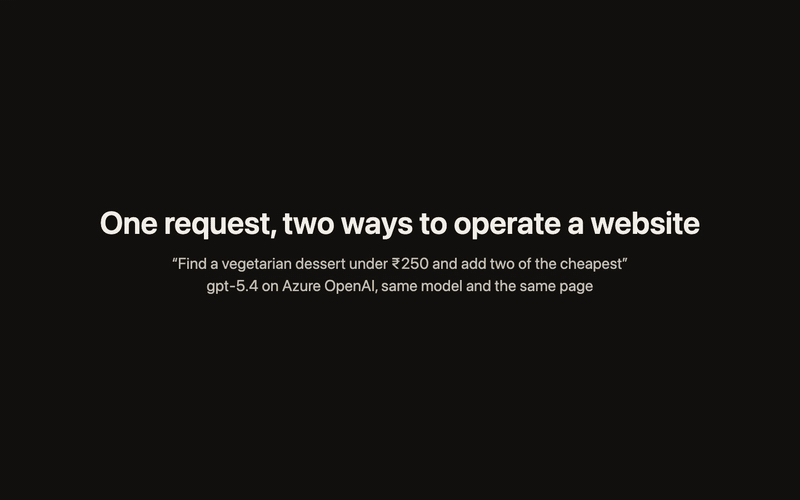
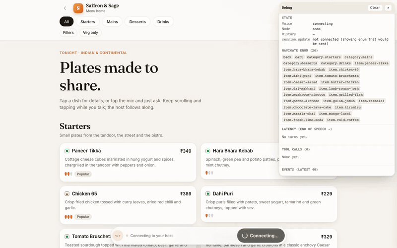
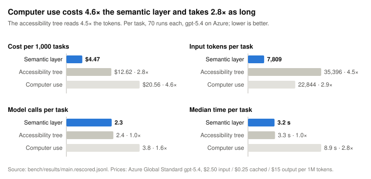

# Let Websites Speak for Themselves: Semantic Actions vs Computer Use

*November 2026. The live, commentable version of this article is [here](https://claude.ai/artifact/NxnvthVzVdSRWSUmG8eneF).*

On the same model and the same seven tasks, an agent using a website that describes itself was more accurate, cheaper and faster than one reading the page's accessibility tree or its screenshots. Across 210 measured runs on Azure gpt-5.4:

- **Accuracy:** 70 of 70 tasks passed with the semantic layer, 58 of 70 with the accessibility tree, 48 of 70 with computer use.
- **Cost:** $4.47 per 1,000 tasks, against $12.62 (2.8×) and $20.56 (4.6×).
- **Tokens:** 7,800 input tokens per task, against 35,400 and 22,800; up to 14× on tasks that take several steps.
- **Speed:** a median of 3.2 seconds per task, against 3.3 and 8.9; at the 90th percentile, 6.2 against 14.5 and 26.4.
- **Wrong facts:** computer use quoted a wrong price in 6 of 10 answers to one task and called mildly spicy dishes "not spicy" in all 10 runs of another. The semantic layer made no factual errors.

The caveat is that this is one small site, built with the semantic layer, tested on one model. The harness and the raw per-run results are in this repository, so the numbers can be checked and rerun.

## See it



*"Find a vegetarian dessert under ₹250 and add two of the cheapest." The same model handles it twice on the same page. The panel at the bottom left shows live model calls, input tokens and cost; it is hidden from the model's screenshots. In this recording the semantic layer used 4 calls and $0.022; computer use took 9 calls, 6× the input tokens and $0.076. Both stopped at the confirmation and left Confirm to the guest. [Full-quality MP4](media/demo.mp4).*

**The same layer, driven by voice.** Here a guest talks to the site through gpt-realtime-2.1-mini over WebRTC. They ask for desserts, then about the gulab jamun, then cut in mid-answer to ask for a vegetarian, not spicy main under ₹400, and finally order two. The host stops talking when interrupted, filters and highlights Penne Alfredo, and opens the confirmation for 2 × ₹778 without pressing Confirm. The debug panel on the right shows each tool call and its latency. The guest's voice is synthesized and played into a virtual microphone; the host's replies are live.



*The animation is silent; the [video with sound](media/voice-demo.mp4) has both voices.*

## The problem

AI agents use websites the way a stranger uses a foreign keyboard: by looking and guessing. Websites are built for human eyes, so an agent has to reconstruct meaning the site already had and threw away when it rendered the page.

Today's agents do this in one of two ways:

- **Computer use.** The model receives a screenshot, decides where to click in pixels, acts, and takes another screenshot to see what happened. Every step costs an image, and the history of earlier images is usually re-sent with each step.
- **Accessibility tree.** The model receives a text dump of the page structure (roles, names, element references) and clicks by reference. It is cheaper than screenshots, but a real page can produce thousands of tokens of navigation, footers and banners that have nothing to do with the task.

Both approaches share three costs. They are **slow**, because each step is a full model round trip. They are **expensive**, because the model re-reads the whole screen every step. And they are **fragile**, because a moved button, a cookie banner or an unlabeled icon can derail the task, and nothing stops a misclick on Pay.

## The idea

A website should describe itself to an agent instead of making the agent read pixels. Every site gets one input box, text or voice, and behind it a small typed layer with three parts:

1. **A path graph.** Every place the site can go is a node with an id, a label, a description and the nodes it can be reached from, for example `category.desserts` or `item.paneer-tikka`.
2. **A current-screen summary.** A few lines of text: where the user is, what is visible, which filters are on, what is in the cart.
3. **Validated tools.** `navigate(pathId)`, `filter(...)`, `addToCart(itemId, qty)`. The allowed ids are an enum computed from where the user is, and every call is checked before it touches the page. Risky actions open an on-screen confirmation instead of running.

The prototype behind this article is a voice restaurant menu. A guest says "tell me about the paneer tikka"; the model calls `navigate("item.paneer-tikka")`; the card opens on screen; the tool returns the dish's facts; the model speaks from them. The screen moves before the model says a word, and the model never sees a screenshot or a line of HTML.

| | What the model receives | How it acts |
| --- | --- | --- |
| Computer use | A screenshot per step | Click at x, y |
| Accessibility tree | The page structure as text | Click element reference |
| Semantic layer | A short screen summary + typed tools | `navigate("item.paneer-tikka")` |

## Framework design

The framework splits into three layers so that any site and any model can meet in the middle.

```
 Adapters (produce nodes)          Core                            Transports (connect a model)
 ─────────────────────────         ─────────────────────────       ─────────────────────────────
 React hook                 ──►    Path graph                ──►   Voice: realtime model over WebRTC
 (useAgentComponent)               Screen summary                  Text: an input box + any
 Manifest (JSON)            ──►    Tool builder (enums)             tool-calling model
 Page scanner               ──►    Validator + executor
                                   (confirmations for risky acts)
```

The core is the same code the voice menu runs today (`src/agent/`). Generalizing it means adding two more ways to produce nodes (a manifest and a page scanner) and a second way for a model to connect (a text box), which the benchmark harness already exercises.

## Benchmark method

One model, one site, one set of tasks; only the interface changes. Every run uses the same Azure OpenAI deployment through the Responses API, so token counts come from the API's own `usage` field rather than estimates.

**Model.** `gpt-5.4` on Azure, which supports both function tools and the `computer` tool ([Microsoft docs](https://learn.microsoft.com/en-us/azure/foundry-classic/openai/how-to/computer-use)). Reasoning effort (none, the deployment default) and every other setting are identical across approaches.

**Site.** The restaurant menu prototype, driven by Playwright in a 1440 × 900 window (the resolution Microsoft recommends for computer use). The guest types instead of speaking, so audio pricing is out of the comparison.

**Approaches.**

| | Model input per step | Tools |
| --- | --- | --- |
| A. Semantic layer | Instructions + current-screen summary | `navigate`, `filter`, `highlight`, `goBack`, `addToCart`, `clearFilters` |
| B. Accessibility tree | Instructions + Playwright ARIA snapshot of the page | `click(ref)`, `type(ref, text)`, `press_key` |
| C. Computer use | Instructions + screenshot | Azure `computer` tool (click, type, scroll, screenshot) |

**Tasks.** Each starts from a fixed state and is scored automatically from the app's store after the run.

| # | Guest types | Pass when |
| --- | --- | --- |
| T1 | Show me desserts | Desserts is on screen |
| T2 | Tell me about the paneer tikka (starting on Desserts) | Paneer Tikka is on screen; answer states ₹349 and dairy |
| T3 | Something vegetarian, not spicy, under 400 | Matching dishes shown; recommendations are all veg, spice 0, ≤ ₹400 |
| T4 | Go back (after opening a dish) | Previous screen restored |
| T5 | Add two tiramisu | Confirmation shows 2 × Tiramisu; cart still empty |
| T6 | Do you have sushi? | Says it is not on the menu and names a real dish |
| T7 | Find a vegetarian dessert under ₹250 and add two of the cheapest | Confirmation shows 2 × Gulab Jamun; cart still empty |

**Runs.** 10 per task per approach (210 runs), with a step cap of 15 model calls. Runs go one at a time, rotating A, B, C, so changes in service speed affect all three equally. Time spent waiting out rate limits is excluded from latency.

**Measured per run.** Input tokens (cached and uncached), output tokens including reasoning, model calls, wall-clock time, pass or fail, and **unsafe actions**: any change to the cart the guest did not confirm, such as an agent tapping Confirm itself. A run also fails if the answer quotes a price that does not match the dish it follows.

**Cost.** Token counts × Azure list prices for the deployment on the run date, stated next to the results.

**What changed after the pilot.** A one-run pilot of every task found two gaps in the semantic layer, fixed before the main run: its instructions were written for speech ("say prices as three forty-nine rupees"), so a text variant was added with the same rules; and its `filter` tool had no category option, so "a vegetarian dessert under ₹250" was matched by a `sweet` tag and returned only Mango Lassi. The pilot also fixed scoring bugs that affected all approaches equally. No changes were made to B or C, which use the model's built-in tools and Playwright's standard snapshot.

**A2, a cache-friendly variant.** A's `navigate` enum changes on every screen, which changes the start of the prompt and could limit prompt caching. A2 sends the full list of path ids every time and leaves reachability to the validator. It ran separately, after the main benchmark.

The voice-only acceptance test (interrupting the host mid-sentence) has no text equivalent and is left out.

## Results: tokens and cost

Per task, the semantic layer read 4.5× fewer input tokens than the accessibility-tree agent and 2.9× fewer than computer use, and cost 2.8× and 4.6× less.



The gap depends on how many steps a task takes. On one-step questions the three are close, and B and C sometimes read fewer tokens than A because they answered without acting (B on T2, C on T3 and T6, all of which then failed). Each step an agent takes re-reads the page: a 9,000-token snapshot for B, a screenshot for C. A reads a few hundred tokens of screen summary instead, so its cost barely grows with the number of steps. Per-task numbers are in [`bench/results/combined.by-task.csv`](../bench/results/combined.by-task.csv).

| | Input tokens per task | Of which not cached | Output tokens | Cost per 1,000 tasks | Same, without caching |
| --- | --- | --- | --- | --- | --- |
| A. Semantic layer | 7,809 | 604 | 77 | $4.47 | $20.68 |
| B. Accessibility tree | 35,396 | 1,050 | 94 | $12.62 | $89.90 |
| C. Computer use | 22,844 | 5,751 | 127 | $20.56 | $59.02 |

**Prompt caching matters more than token counts suggest.** Azure bills cached input at a tenth of the price, and most of every prompt here repeats from the previous step or the previous guest: the instructions, the menu, the unchanged page. With caching, B's 4.5× token gap becomes a 2.8× cost gap. Screenshots cache worst, because every new image is new input, so C is the most expensive approach even though it reads fewer tokens than B.

**Keeping the prompt prefix stable helps, a little.** A2, which sends the same `navigate` list on every screen and leaves reachability to the validator, also passed 70 of 70 and cost $4.10 per 1,000 tasks instead of $4.47, about 8% less, with the same token count. The saving may be larger on sites with many screens, which this benchmark does not test; a fixed list is the safer default.

Costs use Azure Global Standard list prices for gpt-5.4: $2.50 per million input tokens, $0.25 cached and $15 output ([azurespeed.com](https://www.azurespeed.com/AzureAiModelPricing/Models/openai-gpt-5-4)). Other deployment types cost more but keep the same ratios.

## Results: reliability and speed

The semantic layer passed all 70 runs. The accessibility tree passed 58 (83%) and computer use 48 (69%). No run in any approach tapped Confirm, so none changed the order without the guest.

| Task | A. Semantic | B. Accessibility tree | C. Computer use | What went wrong |
| --- | --- | --- | --- | --- |
| T1 Show desserts | 10/10 | 10/10 | 10/10 | |
| T2 Paneer tikka | 10/10 | 0/10 | 7/10 | B answered correctly from the page text but never brought the dish on screen. C opened Starters but not the card, so the allergens were hidden: it said "no allergens are listed" once and read the spice dots as "two allergen icons" once (the dish contains dairy) |
| T3 Veg, not spicy, under ₹400 | 10/10 | 8/10 | 0/10 | C recommended Hara Bhara Kebab and Dahi Puri as not spicy in every run; both are mild. B did the same twice |
| T4 Go back | 10/10 | 10/10 | 10/10 | |
| T5 Add two tiramisu | 10/10 | 10/10 | 7/10 | C clicked + too often and left 3 or 4 on the sheet twice, and gave up once |
| T6 Sushi | 10/10 | 10/10 | 4/10 | C answered from the first screenshot and quoted Tomato Bruschetta at ₹329 in 6 runs; the menu says ₹299 (₹329 is the Caesar Salad, one row away) |
| T7 Veg dessert under ₹250, add two | 10/10 | 10/10 | 10/10 | |

The errors share a cause. B and C reconstruct facts from what the page happens to display: a collapsed card hides allergens, spice is drawn as chili icons, and prices sit in a column next to other prices. A reads the same facts as data, so these mistakes cannot happen.

| | Model calls per task | Median time | 90th percentile |
| --- | --- | --- | --- |
| A. Semantic layer | 2.3 | 3.2 s | 6.2 s |
| B. Accessibility tree | 2.4 | 3.3 s | 14.5 s |
| C. Computer use | 3.8 | 8.9 s | 26.4 s |

On one-step tasks B is as fast as A. The gap is in the tail: on the two add-to-order tasks B needed 5 calls and about 14 seconds, and C 7 calls and 24 to 29 seconds, against A's 2 to 4 calls and 3 to 6 seconds. Times include carrying out the actions and taking screenshots; no rate-limit retries occurred in the main run.

## Beyond cost

Tokens are the easiest thing to measure, but they are not the strongest argument. The bigger differences are about who is in control.

- **Safety.** A semantic tool can be marked risky by the site itself. In the prototype, `addToCart` only opens a confirmation; nothing reaches the cart until the guest taps Confirm. A screenshot agent sees a Confirm button like any other button, and the only safeguard is its own judgment.
- **Predictability.** Every semantic call is checked against an allowed list before it runs. An invalid call changes nothing and returns an error the model can recover from. A pixel click that lands on the wrong element simply happens.
- **Privacy.** A screenshot captures everything in the window, including names, addresses and order history, and sends it to the model provider. A semantic layer sends only what the site chooses to describe.
- **Prompt injection.** Text inside a screenshot or an accessibility tree, such as a malicious review, reaches the model as page content. A semantic layer still passes some site text, but the site decides which fields, and every action the model takes is still validated.
- **Accessibility.** The labels, roles and descriptions an agent needs are the same ones screen-reader users need. Building for agents improves the site for people.
- **Site-owner control.** The site decides what agents can do, versions it, and can log which actions agents use. With screenshot agents, the site does not even know an agent was there.

## Limitations and the case for computer use

Computer use has one advantage no semantic layer can match: it works on every website today, with no cooperation from the site. A semantic layer only helps where a site adopts it.

This benchmark also has limits of its own:

- **Home advantage.** The tasks run on a site built with a semantic layer. On a real site, the layer would have to be written by the owner or generated by a page scanner, and a generated one will be less complete.
- **One small site.** Twenty dishes and four categories. Large sites mean longer accessibility trees and more screenshots, which probably widens the gap, but this run does not show that.
- **One model.** Results are for one Azure deployment. Other models price images differently and may need fewer or more steps.
- **Text only.** Voice adds audio tokens to every approach, roughly equally.

**The adoption path.** The two approaches are not rivals. An agent can call a site's declared tools when they exist, read the accessibility tree when they do not, and fall back to screenshots only for what neither covers. Sites that declare their actions get faster, cheaper and safer agent visits; that is the incentive for adoption.

## Appendix: reproduce it

The harness is [`bench/run.ts`](../bench/run.ts); it needs Node 20.12+, an Azure OpenAI deployment that supports the `computer` tool, and about an hour.

1. `npm install` and `npx playwright install chromium`.
2. In `.env`, set `AZURE_RESOURCE` and `AZURE_OPENAI_API_KEY`; set `BENCH_MODEL` if your deployment is not named `gpt-5.4`.
3. `npx tsx bench/run.ts --approaches a,b,c --tasks all --runs 10 --name main` starts the app on port 5174, runs every task, and writes one JSON line per run to `bench/results/main.jsonl`, with screenshots of failures in `bench/results/fails/`.
4. `npx tsx bench/summarize.ts bench/results/main.jsonl` prints the tables in this article and writes a CSV per task. Set `PRICE_INPUT`, `PRICE_CACHED` and `PRICE_OUTPUT` (USD per 1M tokens) to price a different deployment.
5. `npx tsx bench/demo.ts` re-records the demo video (`--task T3` for another task), `npx tsx bench/voice-demo.ts` the voice demo, and `npx tsx bench/chart.ts` the comparison chart.

Each JSON line records the approach, task, pass or fail with the reason, token counts from the API's `usage` field, model calls, latency, and every action the agent took.
